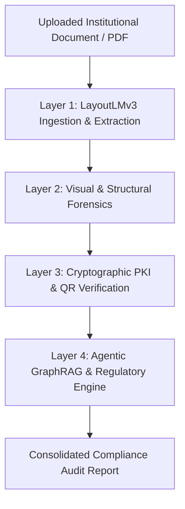

# SATYA — Smart Audit and Transparent Yield Authentication
### AICTE Multi-Layer Compliance & Forensic Verification Engine

SATYA is an intelligent, multi-layered regulatory auditing and document integrity platform designed to automate and verify institutional applications under the **AICTE Approval Process Handbook (APH 2024–2027)**.

---

## 🏛️ Architecture Overview

The system operates across **4 progressive verification layers**:



### Layer 1: Document Ingestion & Layout Analysis (`app/ingestion/`)
- Powered by `microsoft/layoutlmv3-base`.
- Tokenizes page renders, extracts 2D bounding boxes, and classifies regions (headers, key-value tables, institution details, faculty rosters).

### Layer 2: Visual Forensics Engine (`app/forensics/`)
- **Error Level Analysis (ELA)**: Re-compression differential matrices to expose digital splicing and forged seals.
- **Laplacian Edge Inspection**: Detects localized text smoothing, erasure, and synthetic flattening.
- **PDF Metadata Forensics**: Revision history traversal, incremental updates, and modification timestamps.

### Layer 3: Authoritative Source Verification (`app/verification/`)
- **Cryptographic PKI Signatures**: Incremental X.509 certificate parsing, digital signature integrity, and post-signing alteration detection.
- **2D QR Code Validation**: Native PyMuPDF & OpenCV QR detection with authoritative government domain resolution (`*.aicte-india.org`, `*.gov.in`).

### Layer 4: Agentic GraphRAG & Regulatory Engine (`app/knowledge/`)
- **Structure-Aware Chunking**: Hierarchical parsing of chapters, sections, tables, and clauses (~500–800 tokens, 10–15% overlap).
- **Neo4j Knowledge Graph**: Seeds regulatory entities (`:RegulatoryClause`, `:Programme`, `:ApplicationType`, `:Requirement`, `:LocationType`, `:Exception`) and directed relationships (`:MANDATES`, `:HAS_EXCEPTION`, `:APPLIES_TO`).
- **Hybrid Retrieval & RRF**: Dual-path BM25 exact matching + BGE-M3 1024-dimensional dense vector embeddings fused via Reciprocal Rank Fusion ($k=60$).
- **LangGraph Multi-Agent Orchestration**:
  - `Retriever Agent`: Queries hybrid stores and executes controlled 1- to 2-hop Neo4j traversals dynamically filtered on application facts.
  - `Compliance Evaluator Agent`: Audits Layer 1–3 outputs against APH statutory formulas.
  - `Audit Synthesizer Agent`: Synthesizes final regulatory verdicts citing exact APH clauses.
- **Dual LLMs**: Primary Groq Llama 3.1 8B Instruct (`langchain-groq`) with automatic Google Gemini API fallback (`langchain-google-genai`) and deterministic offline evaluation.

---

## 🚀 Quickstart & Setup

### 1. Installation
```bash
git clone https://github.com/sumithshetty2005/SATYA---Smart_Audit_and_Transparent_Yield_Authentication.git
cd SATYA---Smart_Audit_and_Transparent_Yield_Authentication
pip install -r requirements.txt # or install fastapi uvicorn neo4j rank-bm25 langgraph langchain-groq langchain-google-genai pymupdf
```

### 2. Configuration
Copy the template configuration:
```bash
cp .env.example .env
```
Set your credentials in `.env` (Optional — engine runs in deterministic offline mode if keys are absent):
```env
NEO4J_URI=bolt://localhost:7687
NEO4J_USER=neo4j
NEO4J_PASSWORD=password
GROQ_API_KEY=gsk_your_groq_key
GEMINI_API_KEY=your_gemini_key
```

### 3. Run FastAPI Application
```bash
python -m uvicorn main:app --reload --host 0.0.0.0 --port 8000
```
Interactive API documentation: `http://localhost:8000/docs`

---

## 🧪 Testing & Regulatory Evaluations

Run the core compliance test suite:
```bash
python tests/test_compliance.py
```

Run the 8 APH 2024-2027 scenario evaluation benchmarks:
```bash
python tests/test_eval_scenarios.py
```

---

## 📡 API Endpoints

- `POST /api/v1/extract`: Layer 1 LayoutLMv3 document extraction.
- `POST /api/v1/forensics`: Layer 2 Visual Error Level Analysis & edge tampering detection.
- `POST /api/v1/verify-source`: Layer 3 Authoritative PKI & 2D QR verification.
- `POST /api/v1/compliance-audit`: Layer 4 Consolidated Agentic GraphRAG Regulatory Audit.
