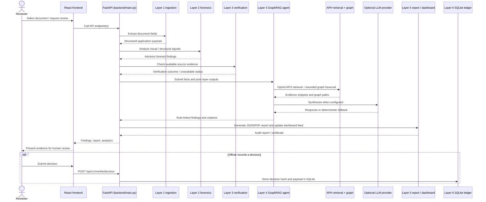

# SATYA Architecture

This diagram follows the currently wired application in `backend/main.py`, the routers in `app/routers/`, and the React client in `frontend/`. It separates the synthetic packet demonstration from the full audit APIs so the demo path is not mistaken for a live regulatory or issuer integration.

## System overview

```mermaid
flowchart LR
  subgraph User[Users]
    Officer[Scrutiny officer / reviewer]
    Applicant[Applicant / portal user]
  end

  subgraph Client[Web client]
    React[React + TypeScript SPA<br/>Vite during development]
    Views[Audit workspace, findings,<br/>dashboards, problem statements]
    React --> Views
  end

  subgraph API["FastAPI application - backend/main.py"]
    Core[Document and compliance endpoints]
    Vision[Layer 5 vision / CV router]
    Verification[Layer 3 verification router<br/>fail-closed prototype routes]
    Reports[Layer 5 analytics and reporting router]
    Merkle[Layer 6 Merkle audit router]
    Portal[Problem statement portal router]
    Demo[Prototype packet review endpoint]
  end

  subgraph Audit[Institutional application audit path]
    Upload[PDF / supporting evidence]
    L1[Layer 1<br/>PDF layout extraction]
    L2[Layer 2<br/>document forensics]
    L3[Layer 3<br/>source / signature verification]
    L4[Layer 4<br/>APH GraphRAG compliance audit]
    L5[Layer 5<br/>reporting, analytics, CV tools]
    L6[Layer 6<br/>SHA-256 Merkle ledger / officer decision]
    Human[Human scrutiny and decision]
    Upload --> L1 --> L2 --> L3 --> L4 --> L5 --> Human
    Human -. optional decision record .-> L6
    L1 -. extracted facts .-> L4
    L2 -. forensic findings .-> L5
    L3 -. verification receipt .-> L5
    L4 -. findings and citations .-> L5
  end

  subgraph Knowledge[Regulatory knowledge services]
    APH[APH 2024–2027 PDF / seeded chunks]
    Retrieval[Hybrid retrieval<br/>BM25 + embeddings + RRF]
    Graph[In-memory graph<br/>with optional Neo4j]
    Agents[LangGraph workflow<br/>retrieve → evaluate → synthesize]
    LLM[Groq primary → Gemini fallback<br/>→ deterministic rules fallback]
    APH --> Retrieval
    APH --> Graph
    Retrieval --> Agents
    Graph --> Agents
    Agents --> LLM
    LLM --> Agents
  end

  subgraph Stores[Local / configured state]
    SQLite[(SQLite Merkle ledger<br/>data/merkle_audit_ledger.db)]
    Dashboard[(In-memory dashboard submissions)]
    Tickets[(In-memory problem statement<br/>and ticket registry)]
  end

  Officer --> React
  Applicant --> React
  Views <-->|HTTP / JSON| Core
  Views <-->|HTTP / JSON| Vision
  Views <-->|HTTP / JSON| Verification
  Views <-->|HTTP / JSON| Reports
  Views <-->|HTTP / JSON| Merkle
  Views <-->|HTTP / JSON| Portal
  Views -->|PDF upload| Demo
  Demo -->|fixture recognition and<br/>defined comparisons only| Views
  Core --> Audit
  L4 --> Agents
  Reports --> Dashboard
  Merkle --> SQLite
  Portal --> Tickets
```

## Audit request flow

## Important boundaries

- The standard development setup runs Vite on port 5173 and proxies `/api` requests to FastAPI on port 8000. FastAPI can also serve a built frontend from `frontend/dist`.
- `POST /api/v1/prototype/review-packet` is a fixture-specific PDF demo: it inventories pages, recognizes the supplied synthetic packet, and reports defined comparisons. It does not contact AICTE, DigiLocker, issuers, banks, or registries, and does not run a live compliance audit.
- Layer 3 verification routes are fail-closed in this prototype. They report unavailable until an authorized registry adapter is configured; no live issuer connection is implied by the architecture.
- The knowledge retriever combines BM25 and vector results with reciprocal-rank fusion, then uses a bounded graph traversal. The code supports an in-memory graph fallback and optional Neo4j; do not assume Neo4j is required for every run.
- Analytics submissions and problem statement/ticket data are held in process memory. The Merkle audit ledger is local SQLite. The diagram does not imply a production database, distributed ledger, or durable storage for dashboard and portal state.
- Layer 5 vision endpoints cover CAD/floor-plan analysis, EXIF/geolocation inspection, asset detection, and combined infrastructure analysis. These are API capabilities and should not be read as proof that every uploaded document automatically passes through each check.
- `backend/main.py` is the canonical FastAPI entry point. It imports the shared modules from the repository-root `app/` package; the Vite development proxy continues to target FastAPI on port 8000.
